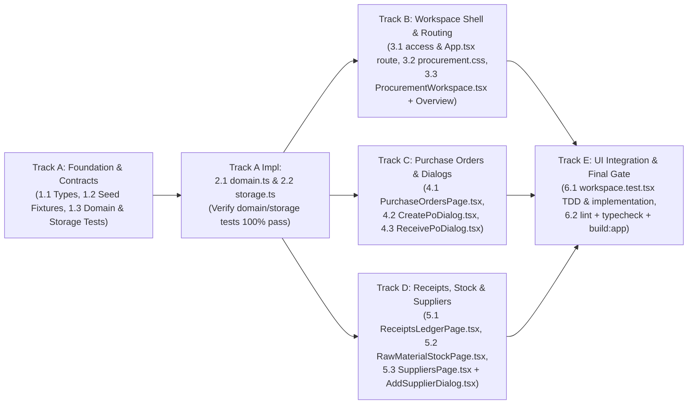

# Tasks: E-Procurement Interactive Prototype

## Module Overview

This task list builds the interactive E-Procurement client demo at `/workspace-preview/procurement/*` in `apps/app`, strictly following TDD and modular file/component limits (<= 500 LOC/file, <= 200 LOC/component).

- Requirements: [requirements.md](./requirements.md)
- Design: [design.md](./design.md)
- Test Spec: [test-spec.md](./test-spec.md)
- Project Guidelines: [guide.md](../../.agents/rules/guide.md) & [AGENTS.md](../../AGENTS.md)

> **Strict TDD Gate**: Under `.agents/rules/guide.md` Section 13, tests in each track must be written and confirmed with the user before writing production implementation code.

---

## Task Dependency Network Diagram (Multi-Agent Execution Plan)

Use this dependency graph to split work across parallel agents without merge conflicts:

### Parallel Agent Assignment Guide
- **Sequential Gate 1 (1 Agent — Architect / Core)**: Completes **Track A** (`types.ts`, `data.ts`, `domain.test.ts`, `storage.test.ts`, `domain.ts`, `storage.ts`). Once `domain.test.ts` and `storage.test.ts` pass, all data contracts and transition signatures are frozen.
- **Parallel Fan-Out (3 Agents Simultaneously)**:
  - **Agent 1 (Track B)**: Owns `App.tsx`, `procurement.css`, `ProcurementWorkspace.tsx`, `ProcurementOverview.tsx`.
  - **Agent 2 (Track C)**: Owns `PurchaseOrdersPage.tsx`, `CreatePoDialog.tsx`, `ReceivePoDialog.tsx`.
  - **Agent 3 (Track D)**: Owns `ReceiptsLedgerPage.tsx`, `RawMaterialStockPage.tsx`, `SuppliersPage.tsx`, `AddSupplierDialog.tsx`.
- **Sequential Gate 2 (1 Agent — QA / Integrator)**: Completes **Track E** (`workspace.test.tsx`, wires any final imports in `ProcurementWorkspace.tsx`, runs `vitest`, `oxlint`, and `tsc -b && vite build`).

---

## Phased Task List

### 1. Track A — Contracts, Fixtures & Test-First Gate
- [x] 1.1 Create `apps/app/src/features/staff-workspace/procurement/types.ts` defining `Supplier`, `RawMaterial`, `ProcurementLine`, `PurchaseOrder`, `ProcurementReceipt`, `StockMovement`, and `ProcurementSnapshot`.
- [x] 1.2 Create `apps/app/src/features/staff-workspace/procurement/data.ts` with `procurementAccess` and realistic bakery seed fixtures (suppliers, raw materials including >= 2 low-stock items, open/received POs, receipts, and movements).
- [x] 1.3 Write unit tests in `__tests__/domain.test.ts` (`TEST-PROC-001` through `TEST-PROC-007`) and `__tests__/storage.test.ts` (`TEST-PROC-008` through `TEST-PROC-010`).
- [x] 1.4 **User Confirmation Gate**: Present written tests and edge-case assertions to the user for confirmation before implementing `domain.ts` and `storage.ts`.

### 2. Track A Implementation — Pure Domain Logic & Storage
- [x] 2.1 Implement `apps/app/src/features/staff-workspace/procurement/domain.ts` (`parseMoney`, `formatMoney`, `calculateLinesTotal`, `getStockStatus`, `createPurchaseOrder`, `cancelPurchaseOrder`, `receivePurchaseOrder`, `recordDirectReceipt`, `addSupplier`, `deriveProcurementKpis`) with full JSDoc blocks.
- [x] 2.2 Implement `apps/app/src/features/staff-workspace/procurement/storage.ts` (`storageKey`, `loadProcurementPreview`, `saveProcurementPreview`, `resetProcurementPreview`) with defensive JSON validation.
- [x] 2.3 Run `pnpm --filter @repo/app test` and verify 100% pass for `domain.test.ts` and `storage.test.ts`.

### 3. Track B — Workspace Shell, Routing, Styles & Overview *(Parallel)*
- [x] 3.1 Create `apps/app/src/features/staff-workspace/procurement/procurement.css` using `--color-*` design tokens and `.pr-*` scoped styles.
- [x] 3.2 Create `apps/app/src/features/staff-workspace/procurement/ProcurementOverview.tsx` (<= 200 LOC) displaying derived KPIs, Low-Stock Alerts with **Reorder** trigger, Recent Receipts, and **Reset Demo Data** button.
- [x] 3.3 Create `apps/app/src/features/staff-workspace/procurement/ProcurementWorkspace.tsx` (<= 200 LOC) wiring `StaffShell`, 5 sidebar navigation links, dialog triggers, `localStorage` save feedback, and unknown-route fallback.
- [x] 3.4 Register `/workspace-preview/procurement/*` in `apps/app/src/App.tsx`.

### 4. Track C — Purchase Orders & Delivery Dialogs *(Parallel)*
- [x] 4.1 Create `apps/app/src/features/staff-workspace/procurement/PurchaseOrdersPage.tsx` (<= 200 LOC) with status filter (`ALL`, `OPEN`, `RECEIVED`, `CANCELLED`), PO table, and per-row **Receive Delivery** / **Cancel** actions.
- [x] 4.2 Create `apps/app/src/features/staff-workspace/procurement/CreatePoDialog.tsx` (<= 200 LOC) supporting supplier selection, pre-filled low-stock material, multi-line items, live total calculation, and validation errors.
- [x] 4.3 Create `apps/app/src/features/staff-workspace/procurement/ReceivePoDialog.tsx` (<= 200 LOC) supporting PO-linked delivery or Direct Receipt, supplier invoice reference input, quantity confirmation, and inline error feedback.

### 5. Track D — Receipts Ledger, Stock & Suppliers *(Parallel)*
- [x] 5.1 Create `apps/app/src/features/staff-workspace/procurement/ReceiptsLedgerPage.tsx` (<= 200 LOC) showing append-only posted receipts and expandable/inline inbound stock movement summary.
- [x] 5.2 Create `apps/app/src/features/staff-workspace/procurement/RawMaterialStockPage.tsx` (<= 200 LOC) showing SKU, stock, threshold, status badge (`OK`, `LOW`, `CRITICAL`), and **Reorder** button.
- [x] 5.3 Create `apps/app/src/features/staff-workspace/procurement/SuppliersPage.tsx` and `AddSupplierDialog.tsx` (each <= 200 LOC) for viewing vendors and adding a new supplier.

### 6. Track E — UI Integration Tests & Acceptance Verification
- [x] 6.1 Write `__tests__/workspace.test.tsx` (`TEST-PROC-011` through `TEST-PROC-014`) covering routing, isolation, reorder prefill, and the complete PO -> Receive -> Stock & Ledger demo loop; confirm with user if needed.
- [x] 6.2 Run full validation suite:
  - `pnpm --filter @repo/app test`
  - `pnpm --filter @repo/app lint`
  - `pnpm build:app`
- [ ] 6.3 Perform manual visual/keyboard walkthrough of `/workspace-preview/procurement` in the browser to confirm demo readiness.

---

## Acceptance Gate

The prototype is ready for client presentation only when:
- [x] All 14 test scenarios (`TEST-PROC-001`..`TEST-PROC-014`) pass with 0 failures or skipped assertions.
- [x] `pnpm --filter @repo/app lint` and `pnpm build:app` exit with code `0`.
- [ ] Every file is <= 500 LOC, every component is <= 200 LOC, and all exported functions/components include compliant JSDoc blocks.
- [ ] A presenter can complete the full loop in the browser: **Low-Stock Alert -> Reorder (Create PO) -> Receive Delivery -> Stock Incremented & Receipt Logged -> Reset Demo Data**.

